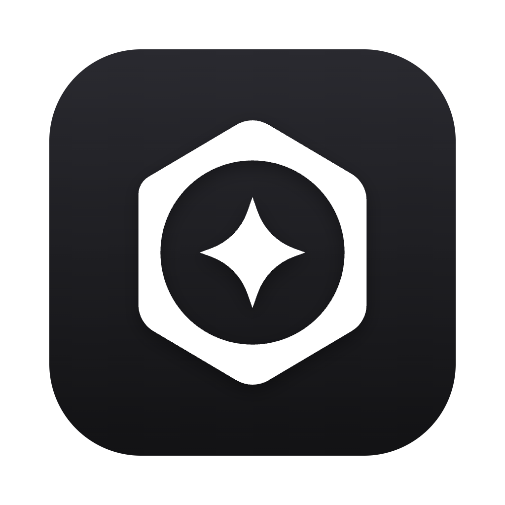
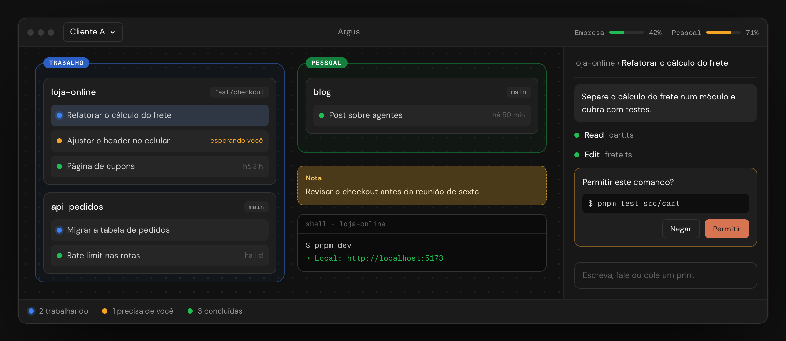
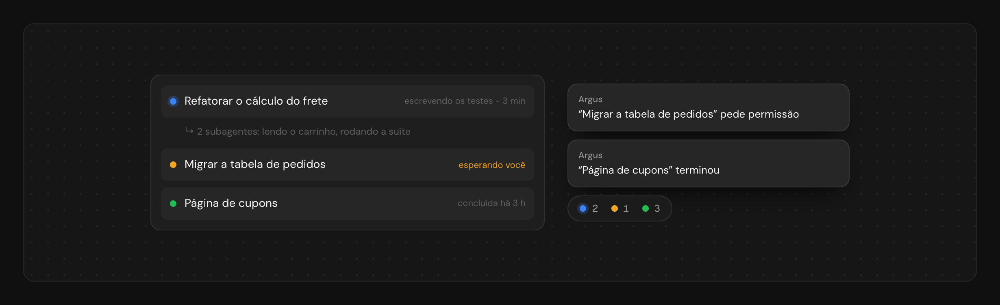
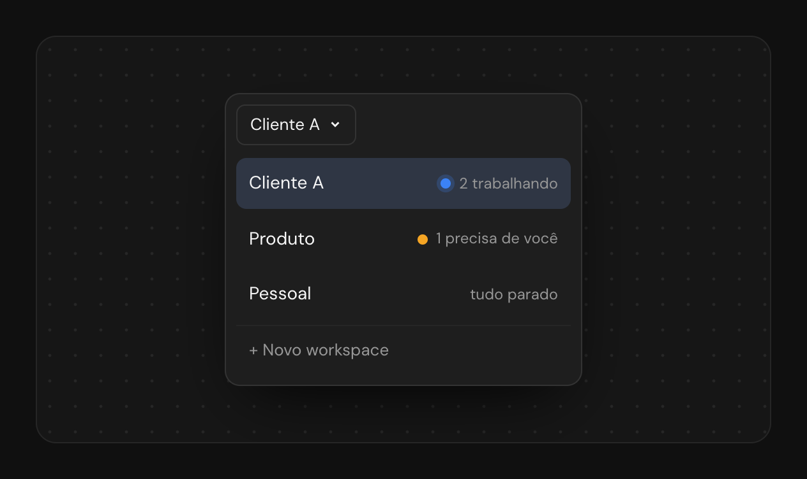
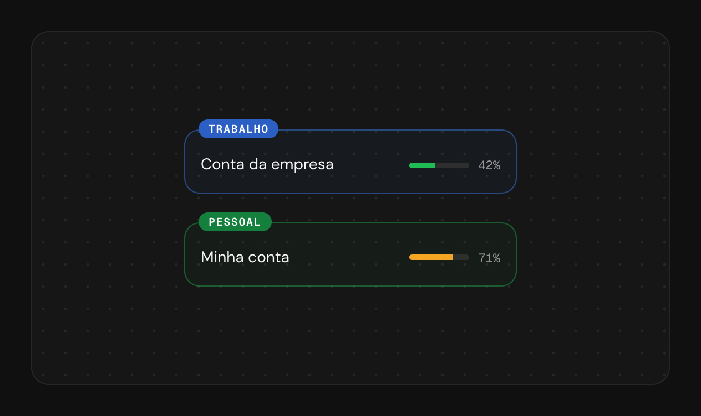
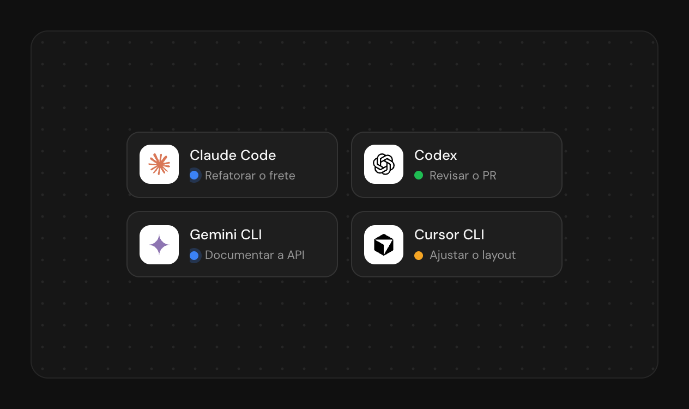
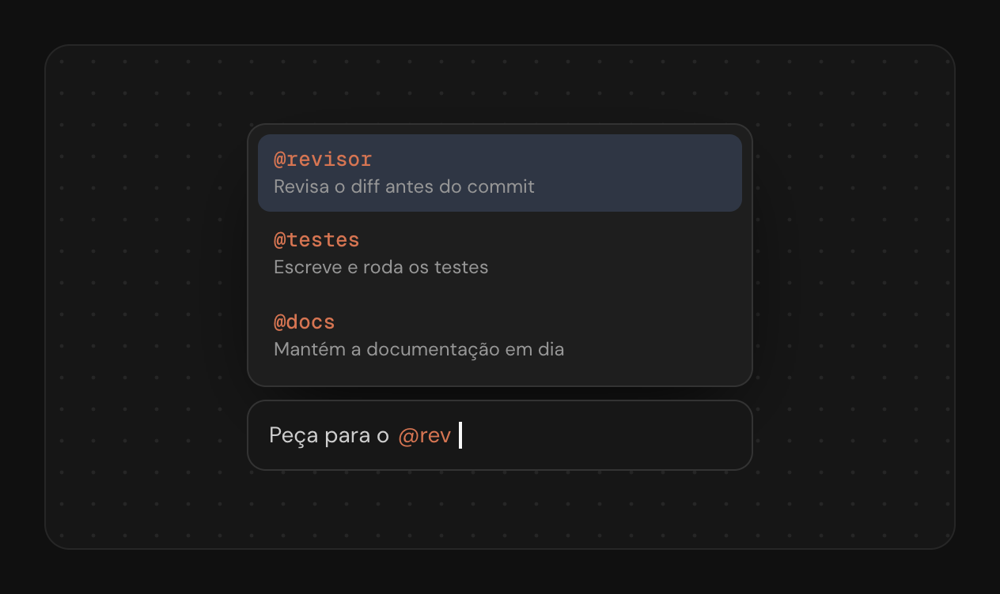
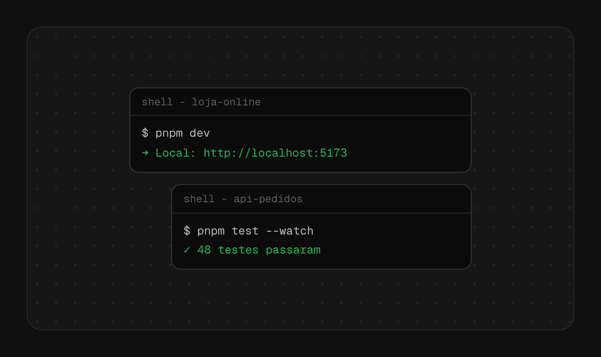
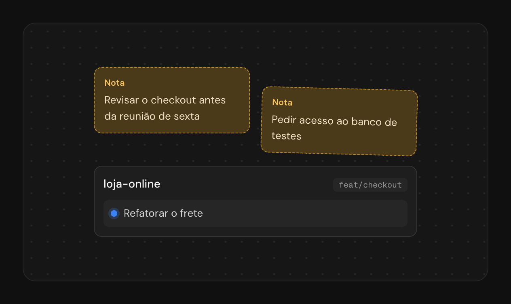
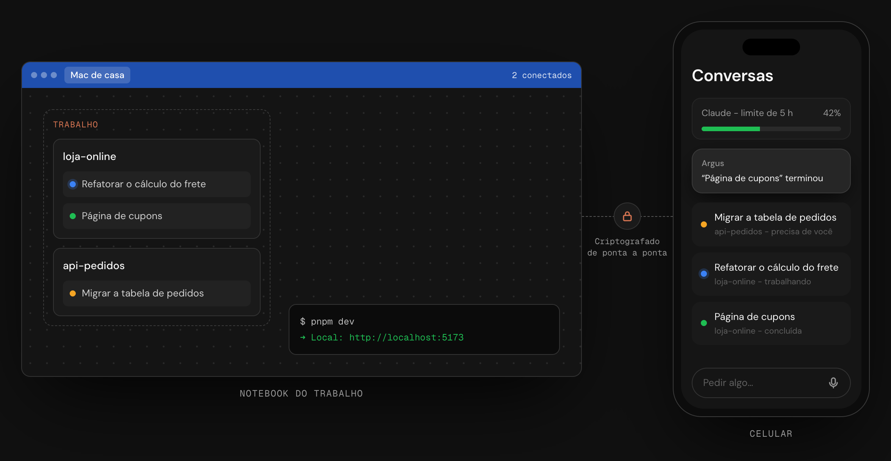

<p align="center">
  
</p>

<h1 align="center">Argus</h1>

<p align="center">
  <b>Ferramenta para quem quer performar de verdade com agentes de código.</b><br>
  Um canvas para tocar vários projetos ao mesmo tempo com Claude Code, Codex, Gemini e Cursor, com tudo à vista.
</p>

<p align="center">
  <a href="https://github.com/ffernandomoraes/argus/releases/latest"><b>Baixar o Argus</b></a>
  -
  <a href="https://argusterm.com">Site</a>
  -
  <a href="https://argusterm.com/novidades">Novidades</a>
</p>

<p align="center">
  macOS (Apple Silicon) - Windows 10 e 11 - Linux (AppImage) - projetos no WSL
</p>



<p align="center"><sub>Ilustração do app, com projetos de exemplo.</sub></p>

Usa o Claude Code e a assinatura que você já tem. Sem chave de API, sem conta no Argus, grátis.

## Por que o Argus

Com vários agentes trabalhando ao mesmo tempo, o que segura você não é escrever código: é
acompanhar, aprovar e revisar tudo sem se perder. O Argus junta tudo num canvas só.

- **Veja tudo de uma vez.** Cada projeto é um bloco, com as conversas e o status de cada uma. Um
  olhar e você sabe o que está rodando, o que terminou e o que espera você.
- **Organize do seu jeito.** Grupos coloridos por cliente ou contexto, um workspace para cada
  frente de trabalho e notas soltas ao lado dos projetos.
- **Toque mais coisas em paralelo.** Várias conversas e terminais rodando ao mesmo tempo. Você só
  para quando o Argus avisa que alguém terminou ou precisa de uma resposta.

## Feito para quem toca vários projetos

<table>
<tr>
<td colspan="2" valign="top">
<br>
<b>Saiba a hora de agir</b><br>
Cada conversa mostra o que o agente está fazendo agora e há quanto tempo. Quando uma termina, pede permissão ou faz uma pergunta, chega a notificação. A barra de baixo resume todas, de todos os workspaces.
</td>
</tr>
<tr>
<td width="50%" valign="top">
<br>
<b>Um workspace para cada frente</b><br>
Clientes, produtos ou estudos em canvas separados, trocados pela barra de cima. O que roda nos outros continua aparecendo.
</td>
<td width="50%" valign="top">
<br>
<b>Uma conta para cada grupo</b><br>
A conta da empresa num grupo, a pessoal em outro. Pastas, conversas e terminais usam a conta do grupo, com o limite de cada uma à vista.
</td>
</tr>
<tr>
<td width="50%" valign="top">
<br>
<b>O agente que você preferir</b><br>
Claude Code, Codex, Gemini CLI e Cursor CLI lado a lado, cada conversa com o agente e o modelo certos para a tarefa.
</td>
<td width="50%" valign="top">
<br>
<b>Seus agentes em todos os projetos</b><br>
Monte uma biblioteca de agentes especialistas uma vez e chame qualquer um com <code>@</code> em qualquer conversa, de qualquer projeto.
</td>
</tr>
<tr>
<td width="50%" valign="top">
<br>
<b>Vários terminais, lado a lado</b><br>
Terminais soltos no canvas, ao lado da pasta: o servidor de um projeto e os testes de outro à vista ao mesmo tempo.
</td>
<td width="50%" valign="top">
<br>
<b>Notas ao lado do trabalho</b><br>
Lembretes soltos no canvas, perto do projeto de que eles falam. O que falta fazer fica onde o trabalho acontece.
</td>
</tr>
</table>

## Saiu de perto? O Argus vai junto

Deixe o Argus ligado num computador e use de outro, ou acompanhe pelo celular. Os projetos e as
conversas continuam onde estão.



- **De um computador para outro:** no notebook, o Argus de casa abre inteiro, com canvas,
  conversas, terminais e arquivos. Funciona entre Mac, Windows e Linux.
- **No celular:** aponte a câmera para o QR code. Veja o uso e as conversas, mande pedidos por
  texto, voz ou foto e receba aviso quando algo termina.
- **Só entra quem você pareou:** código de uso único, conexão criptografada de ponta a ponta e a
  lista de quem está conectado sempre à vista.

## Argus x editor de código

| | Editor de código | Argus |
|---|---|---|
| **Vários projetos** | Uma janela por projeto, uma de cada vez na frente. | Todos os projetos num canvas, agrupados por cliente ou contexto. |
| **Conversas com agentes** | Um painel lateral, com uma conversa à vista por vez. | Várias conversas em paralelo, cada uma com o status. |
| **Saber a hora de agir** | Você volta para conferir se terminou. | O Argus avisa quando uma conversa termina ou pede permissão. |
| **Agentes** | Um agente por extensão, cada um no seu painel. | Claude Code, Codex, Gemini CLI e Cursor CLI lado a lado. |
| **Contas do Claude** | Uma conta logada por vez. | Uma conta por grupo: trabalho, freela e pessoal separados. |
| **Longe do computador** | Feito para usar na frente dele. | Continue pelo notebook ou pelo celular. |

O Argus não substitui o seu editor: ele tem árvore de arquivos e editor para ajustes rápidos, e
você continua usando o seu editor no resto.

## Quem usa, recomenda

> O Argus aumentou minha produtividade. Consigo gerir vários projetos ao mesmo tempo e não perco
> a memória de nenhum deles.
>
> **João Andrade**, AI Product Engineer na HAYAH

> Estamos usando o Argus nos nossos projetos e conseguimos melhorar muito a contextualização e a
> memória da IA. Agora a IA performa muito mais, com agentes especialistas para cada frente.
>
> **Henrique Lati**, Tech Lead na Z2Pay

> Estamos testando com o nosso time e, para trabalhar com workspaces e vários desenvolvedores, ele
> tem nos ajudado muito.
>
> **Murilo Lamarca**, Specialist Product Designer na Locaweb

## Comece em menos de 5 minutos

1. **Baixe o Argus** em [Releases](https://github.com/ffernandomoraes/argus/releases/latest).
   Depois de instalado, ele se atualiza sozinho.
2. **Entre com o Claude.** O Argus usa o Claude Code da sua máquina e a assinatura que você já
   tem. Se faltar, as boas-vindas instalam com um clique.
3. **Arraste uma pasta** para o canvas, ou rode `argus .` no terminal, e comece a conversar.

No macOS e no Linux, um comando baixa, instala e abre (rodar de novo atualiza):

```bash
curl -fsSL https://raw.githubusercontent.com/ffernandomoraes/argus/main/install.sh | sh
```

<details>
<summary><b>Instalação passo a passo e requisitos</b></summary>

### Requisitos

- Mac com Apple Silicon (M1 ou mais novo), PC com Windows 10 ou 11 de 64 bits, ou PC com Linux de
  64 bits (Intel/AMD).
- [Claude Code](https://docs.claude.com/claude-code), que as boas-vindas instalam se faltar.
- No Windows, o [Git for Windows](https://git-scm.com/download/win); no Linux, o git da
  distribuição (`sudo apt install git`).

### macOS pelo .dmg

1. Baixe o `Argus-<versão>-arm64.dmg` em [Releases](https://github.com/ffernandomoraes/argus/releases/latest)
   e arraste o Argus para Aplicativos.
2. Na primeira vez, o macOS bloqueia a abertura, porque o app não é notarizado pela Apple. Vá em
   **Ajustes do Sistema › Privacidade e Segurança** e clique em **Abrir Mesmo Assim**.

### Windows

1. Baixe o `Argus-Setup-<versão>.exe` em [Releases](https://github.com/ffernandomoraes/argus/releases/latest) e abra.
2. Se aparecer **O Windows protegeu o computador**, clique em **Mais informações › Executar assim
   mesmo** (o app não tem certificado pago de assinatura).
3. Ele instala na sua pasta de usuário, sem pedir administrador, e cria os atalhos.

### Linux

O comando acima baixa o AppImage para `~/Applications/Argus.AppImage`. Ou baixe o
`Argus-<versão>-x86_64.AppImage` em [Releases](https://github.com/ffernandomoraes/argus/releases/latest),
dê permissão de execução (`chmod +x`) e abra.

### Atualizações e comando `argus`

O Argus procura versão nova ao abrir e a cada 5 horas e baixa em segundo plano; um clique em
**Atualizar** na barra de título reinicia já atualizado. Para abrir pastas pelo terminal, ative o
comando `argus` em **Configurações › Geral** e rode `argus .` em qualquer pasta.

</details>

## Perguntas frequentes

<details>
<summary><b>Para quem é o Argus?</b></summary>

Para quem trabalha com agentes de código em mais de um projeto: quem atende vários clientes, cuida
de vários repositórios ou deixa tarefas rodando em paralelo. Com um projeto só e uma conversa por
vez, o terminal já resolve.
</details>

<details>
<summary><b>Qual a diferença para usar o agente no terminal?</b></summary>

O agente é o mesmo, com o mesmo `CLAUDE.md`, as mesmas configurações e os mesmos MCPs. A diferença
é ver todas as conversas juntas, com status, diff e permissões, sem caçar abas.
</details>

<details>
<summary><b>Meu código sai da minha máquina?</b></summary>

O app roda local. As conversas vão para o modelo do mesmo jeito que iriam pelo terminal. No acesso
remoto, a ponte entre os aparelhos só repassa dados criptografados de ponta a ponta. Detalhes na
página de [privacidade](https://argusterm.com/privacidade).
</details>

## Desenvolvimento

Monorepo com pnpm workspaces:

| Pasta | O que tem |
|---|---|
| `apps/desktop` | O Argus (Electron) |
| `apps/mobile` | App do celular (PWA) do acesso remoto |
| `apps/relay` | Ponte do acesso remoto (Cloudflare Worker), que também serve o app do celular |
| `apps/telemetry` | Dados de uso anônimos (Cloudflare Worker + D1) e o painel |
| `apps/website` | O site, [argusterm.com](https://argusterm.com) |
| `packages/shared` | Tipos e lógica do desktop e do celular (`@argus/shared`) |
| `packages/ui` | Componentes React do desktop e do celular (`@argus/ui`) |

```bash
pnpm install       # também compila o ditado (precisa das Command Line Tools da Apple)
pnpm dev           # abre o app com recarga automática
pnpm typecheck
pnpm test
pnpm dist          # .dmg e .zip em apps/desktop/dist/
pnpm dist:win      # instalador do Windows (rode num Windows)
pnpm mobile:dev    # app do celular no navegador
```

A versão de desenvolvimento usa dados e comando `argus` próprios e roda ao lado da instalada.
Rodando de dentro do VS Code ou do Claude Code, use `env -u ELECTRON_RUN_AS_NODE pnpm dev`.

Stack: Electron, React, TypeScript, electron-vite, React Flow, Tailwind, CodeMirror, xterm.js com
node-pty e o [Claude Agent SDK](https://docs.claude.com/en/api/agent-sdk/overview). Mais detalhes
em [docs/](docs/).

As imagens do README são as ilustrações do site (`apps/website`), não prints do app. Mudou o
site? Rode `sh scripts/capture-readme-images.sh` para trocá-las (precisa da
[agent-browser](https://github.com/vercel-labs/agent-browser)).

<details>
<summary><b>Gerar uma versão</b></summary>

Todo push na `main` vira uma versão: o workflow **Release** sobe o patch no
`apps/desktop/package.json`, cria a tag, monta os instaladores de macOS, Windows e Linux, publica o
release e usa os títulos dos commits como notas. Pushes que só mexem em `.md` não geram versão.

Para subir minor ou major, ou escrever as notas à mão:

```bash
gh workflow run release.yml -f bump=minor -f notas="- item 1
- item 2"
```

A assinatura do Mac usa o certificado autoassinado dos secrets do repositório (`MAC_CERT_P12`,
`MAC_CERT_PASSWORD`, `MAC_SIGN_IDENTITY`). Sem eles, cada versão conta como um app novo para o
macOS, que volta a pedir o microfone.

</details>

## Licença

MIT com a [Commons Clause](https://commonsclause.com): qualquer pessoa pode usar, modificar e
distribuir o Argus de graça, inclusive no trabalho, mas não pode vendê-lo nem cobrar por um
produto ou serviço que seja basicamente ele. Texto completo em [LICENSE](LICENSE).

---

Projeto pessoal, sem vínculo com a Anthropic. Claude e Claude Code são marcas da Anthropic.
